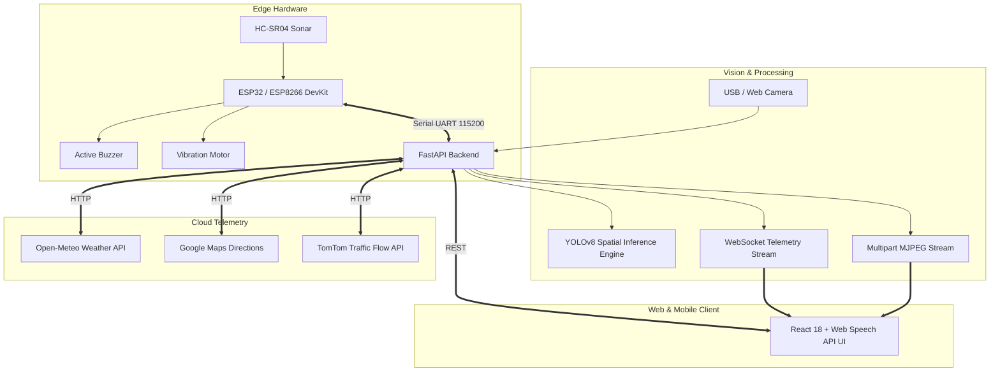

# SafePath AI

## AI-Powered Climate-Resilient Road Safety and Intelligent Mobility Platform for Safe Pedestrian Navigation in Smart Cities

[](https://www.python.org/)
[](https://fastapi.tiangolo.com/)
[](https://reactjs.org/)
[](https://github.com/ultralytics/ultralytics)
[](https://espressif.com/)

---

## 📌 Executive Summary

**SafePath AI** is an advanced, production-grade intelligent mobility and pedestrian safety platform developed for final-year Computer Science and Engineering (CSE) major project submission and smart city deployment. 

The platform integrates **edge computer vision (YOLOv8)**, **microcontroller IoT telemetry (ESP32 / ESP8266 + HC-SR04 ultrasonic sonar)**, **real-time spatial threat modeling**, **meteorological climate resilience (Open-Meteo)**, and **Google Maps Platform** into a dark navy command center.

---

## 🏗️ System Architecture



---

## 🚀 How to Run in PyCharm (Recommended)

1. Open this project in **PyCharm**.
2. Open `main.py` in the project root.
3. Right-click inside `main.py` and select **Run 'main'** (or press <kbd>Shift</kbd> + <kbd>F10</kbd>).
4. The PyCharm Run console starts the FastAPI server and automatically opens your web browser to:
   * **Web Dashboard**: `http://127.0.0.1:8000/`
   * **Interactive API Documentation**: `http://127.0.0.1:8000/docs`

### Alternative Launchers
* **Windows One-Click**: Double-click `run_safepath.bat`.
* **Automated Test Suite**: Run `python test_safepath.py` in PyCharm terminal to run all 9 system verification checks.

---

## 🗺️ Google Maps Setup

SafePath AI integrates the official Google Maps Platform with browser Geolocation, walking route calculations, and turn-by-turn guidance:

1. Copy `frontend/.env.example` to `frontend/.env`:
   ```bash
   cp frontend/.env.example frontend/.env
   ```
2. Open `frontend/.env` and insert your API key:
   ```env
   VITE_GOOGLE_MAPS_API_KEY=your_actual_key_here
   ```
3. In [Google Cloud Console](https://console.cloud.google.com/), ensure the following APIs are enabled for your key:
   * **Maps JavaScript API**
   * **Places API**
   * **Directions API**
4. Rebuild the frontend (`cd frontend && npm run build`) or run in development mode.
*(Note: If no key is configured, SafePath AI automatically runs in demonstration fallback mode with OSRM routing so all features remain testable during evaluation).*

---

## 🧩 The 8 Core Platform Modules

| # | Module | Route | Functionality |
| :-: | :--- | :--- | :--- |
| **1** | **Overview** | `/` | Real-time health matrix across backend, camera, YOLO model, voice, and serial IoT. |
| **2** | **AI Safety Assistance** | `/detection` | Live webcam feed, YOLOv8 bounding boxes, webcam selector, spoken warnings, and road surface/pothole inspection. |
| **3** | **Smart Navigation** | `/navigation` | Google Maps routing, browser geolocation, turn-by-turn walking directions, and climate safety index. |
| **4** | **Traffic Intelligence** | `/traffic` | Urban vehicle speeds, congestion ratios, and pedestrian crossing threat evaluations. |
| **5** | **Weather Intelligence** | `/weather` | Open-Meteo meteorological metrics, sidewalk friction physics ($\mu$), and climate attenuation factor. |
| **6** | **Hardware & IoT** | `/hardware` | COM port auto-scanner, live HC-SR04 sonar gauge, diagnostic buzzer tests, simulation mode, and wiring pinouts. |
| **7** | **Safety History** | `/history` | Timestamped incident logs, collision avoidance auditing, CSV & JSON data export. |
| **8** | **Settings** | `/settings` | Confidence thresholds, speech rate, frame resolution, and API credential management. |

---

## 🔌 Hardware Wiring & Pinouts

### ESP32 DevKit V1 (Recommended)
| Component | Pin | ESP32 GPIO | Electrical Requirement |
| :--- | :--- | :--- | :--- |
| **HC-SR04** | TRIG | `GPIO 5` | Direct connection |
| **HC-SR04** | ECHO | `GPIO 18` | 1kΩ / 2kΩ voltage divider to 3.3V logic (or use HC-SR04P) |
| **Active Buzzer** | (+) | `GPIO 23` | Direct or 2N2222 transistor driver |
| **Vibration Motor**| (+) | `GPIO 22` | **Must use NPN 2N2222 transistor** with 1kΩ base resistor and 1N4001 flyback diode |
| **Common GND** | (-) | `GND` | Common ground bus |

*Firmware:* `firmware/safepath_esp32/safepath_esp32.ino` (Baud: 115200)

### ESP8266 (NodeMCU)
* **TRIG**: `D1 (GPIO 5)`
* **ECHO**: `D2 (GPIO 4)` (Requires 3.3V voltage divider)
* **Buzzer**: `D5 (GPIO 14)`
* **IR Sensor**: `D6 (GPIO 12)`
* **Rain Sensor**: `D7 (GPIO 13)`

*Firmware:* `firmware/safepath_esp8266/safepath_esp8266.ino` (Baud: 115200)

---

## 📡 Serial Protocol (v2.0)

SafePath AI uses a bidirectional, newline-delimited command protocol:

* `ALERT_LEVEL:0` — Clear all alerts; silence buzzer and vibration.
* `ALERT_LEVEL:1` — Low warning: Soft intermittent beep (1900ms interval).
* `ALERT_LEVEL:2` — Moderate hazard: Medium beep (900ms interval).
* `ALERT_LEVEL:3` — High hazard: Rapid beep (380ms) + vibration pulses.
* `ALERT_LEVEL:4` — Critical collision risk: Continuous alarm (160ms) + persistent vibration.
* `DISTANCE_CM:XX.X` — Real-time ultrasonic sonar distance measurement.
* `TEST` — Fires a 350ms diagnostic buzzer and vibration pulse.
* `PING` / `PONG` — Round-trip serial latency heartbeat.

---

## 📄 License & Academic Attribution
Developed as a final-year CSE Major Project under academic research guidelines. Research prototype — not certified as an automotive collision prevention system.
